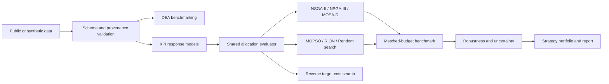

# Department Resource Allocation Optimizer

A reproducible decision-support framework for exploring how an academic department can
allocate limited money, faculty effort, research support, and infrastructure across
competing goals.

The project began as **Department-Rank-Improver**, a hybrid NSGA-II/PSO experiment named
RION. It now provides a tested optimization pipeline with data validation, DEA
benchmarking, KPI response models, shared feasibility constraints, six search methods,
matched-budget experiments, robustness analysis, target-cost optimization, and strategy
reporting.

> [!IMPORTANT]
> Example results use synthetic or illustrative data to demonstrate the methodology.
> They do not prove that a recommended allocation will improve a particular institution
> or ranking outcome. Institution-specific conclusions require appropriately sourced
> and validated data.

## What the project answers

The central decision question is:

> How should a department allocate available resources across research, innovation,
> student development, and societal contribution while satisfying budget, effort,
> capacity, and service constraints?

The optimizer searches controllable allocations and predicts their KPI consequences.
Observed publications, citations, outcomes, and rank are evaluation data; they are not
free decision variables in the modern workflow.

## Highlights

- Corrected and reproducible **RION** hybrid optimizer with serial and optional OpenMP
  PSO backends.
- Shared mixed-variable allocation evaluator with named constraints, deterministic
  repair, integrality checks, feasibility-first comparison, and uncertainty metadata.
- Canonical **NSGA-II**, **NSGA-III**, **MOEA/D**, **MOPSO**, **RION**, and random-search
  adapters using the same evaluator and output schema.
- Input-oriented variable-returns-to-scale **DEA** methodology fixture.
- Mean, linear, and Random Forest KPI model comparison with validation and prediction
  intervals.
- Resume-safe benchmarks with matched candidate-evaluation budgets.
- Hypervolume, IGD, spacing, feasibility, runtime, paired Wilcoxon tests, rank-biserial
  effects, and Holm correction.
- Budget, policy, resource-shock, and Monte Carlo robustness workflows.
- Conservative, balanced, research-first, and other evidence-supported strategy views.
- Reverse optimization for finding a feasible allocation that reaches KPI targets at
  low cost.
- Reproducible completion audit with independent metric recomputation.

## System overview



All optimizers call the same evaluator:

```text
allocation + context + model
    -> repaired allocation
    -> raw KPI predictions and uncertainty
    -> objective vector
    -> constraint residuals and feasibility
    -> evidence and model-support flags
```

## Requirements

- Python 3.10 or newer
- `make` for the documented convenience commands
- An OpenMP-capable C compiler only if using the optional native PSO backend

Python dependencies are pinned by compatible version ranges in
[`requirements.txt`](requirements.txt): NumPy, pandas, SciPy, scikit-learn, and joblib.

## Quick start

Clone the repository, create an isolated environment, and install the dependencies:

```bash
git clone <repository-url>
cd Department-Rank-Improver

python3 -m venv .venv
source .venv/bin/activate
python -m pip install --upgrade pip
python -m pip install -r requirements.txt
```

Run the test suite:

```bash
make test
```

Run a small end-to-end allocation workflow:

```bash
make train-models
make allocation-small
```

Run the reproducibility audit:

```bash
make completion-audit
```

Generated artifacts are written under `artifacts/` and `results/`. Existing saved
outputs are retained unless a workflow's documented stable output directory is reused.

## Reproducible workflows

| Command | Purpose | Main output |
| --- | --- | --- |
| `make` or `make main` | Corrected legacy RION baseline | `results/baseline_seed_42/` |
| `make test` | Full unit and integration test suite | Terminal results |
| `make data-audit` | Validate and classify the legacy dataset | `artifacts/data_audit/` |
| `make generate-synthetic` | Generate a configured synthetic dataset | Configured generator path |
| `make dea` | Run the DEA methodology fixture | `artifacts/dea/` |
| `make train-models` | Train and validate KPI response models | `artifacts/models/` |
| `make allocation-evaluator` | Reproduce a shared-evaluator reference case | `artifacts/allocation/` |
| `make allocation-small` | Run a small end-to-end optimizer comparison | `results/allocation_runs/` |
| `make allocation-phase5` | Run all integrated optimization tracks | `results/allocation_runs/` |
| `make benchmark-smoke` | Run/resume the three-seed integration benchmark | `results/benchmarks/phase6-smoke-synthetic-v1/` |
| `make benchmark-final` | Run/resume the 25-seed benchmark | `results/benchmarks/phase6-final-synthetic-25seeds-v1/` |
| `make robustness-smoke` | Run budget, policy, shock, and uncertainty scenarios | `results/robustness/phase6b-synthetic-v1/` |
| `make strategy-report` | Build the saved-artifact strategy report | `results/reporting/phase7-synthetic-v1/` |
| `make target-cost` | Minimize cost subject to KPI targets | `results/target_cost/` |
| `make extension-assessment` | Check Network DEA and multi-period evidence gates | `results/extensions/` |
| `make completion-audit` | Reproduce and independently audit completion claims | `results/audit/phase12-completion-audit-v1/` |

Set a different interpreter when needed:

```bash
make test PYTHON=/path/to/python
```

## Running custom configurations

The modern allocation workflow is configuration driven:

```bash
python main.py allocation \
  --config configs/optimization/small_synthetic.json \
  --output-root results/my-allocation-run
```

The corrected legacy RION workflow remains available:

```bash
python main.py \
  --seed 42 \
  --generations 20 \
  --population-size 50 \
  --pso-iterations 10 \
  --pso-backend serial
```

Each baseline run exports the final population, feasible rank-zero archive, and exact
run configuration. Use `python main.py --help` or `python main.py allocation --help`
for CLI options.

## Optimization model

The shared problem definition treats resource allocation as the decision vector.
Configured variables can be continuous, discrete, or integer and may represent funding,
faculty effort, research-assistant capacity, collaborations, or other supported actions.

The evaluator enforces:

- total monetary budget;
- total faculty effort;
- named lower and upper bounds;
- integer and increment requirements;
- minimum teaching, student, and service commitments;
- capacity and dependency rules; and
- model-support or extrapolation warnings.

Feasible candidates are compared by Pareto dominance. A feasible candidate always
beats an infeasible candidate; infeasible candidates are ordered by normalized total
constraint violation.

The target design contains four benefit families:

1. Research impact
2. Innovation
3. Student development
4. Societal contribution

Unsupported families remain explicitly flagged. The current synthetic response fixture
supports research behavior; the other three objective scores are not evidence-backed
departmental response models yet.

## Reference synthetic benchmark

The final benchmark uses 25 matched seeds and 100 candidate evaluations for each of six
methods: **150 runs and 15,000 candidate evaluations**, with zero failures and zero
budget overshoot.

| Algorithm | Median hypervolume | Median IGD |
| --- | ---: | ---: |
| MOPSO | 0.0006863 | 0.00523 |
| MOEA/D | 0.0006845 | 0.00704 |
| NSGA-II | 0.0006803 | 0.01117 |
| Random search | 0.0006787 | 0.01282 |
| NSGA-III | 0.0006786 | 0.01288 |
| RION | 0.0006573 | 0.03424 |

MOPSO recorded the strongest medians on this fixture, but its paired results were not
statistically distinguishable from MOEA/D after Holm correction. The benchmark has one
meaningfully supported objective family, and IGD uses an approximate pooled reference
front. It therefore does not establish a generally best algorithm.

Detailed outputs are in
[`results/benchmarks/phase6-final-synthetic-25seeds-v1/`](results/benchmarks/phase6-final-synthetic-25seeds-v1/).

## Data and evidence policy

Every dataset or generated field must be traceable. The workflows distinguish:

- `observed_public`: values directly extracted from an authoritative public source;
- `derived_public`: values calculated from public evidence using a documented rule;
- `synthetic_calibrated`: reproducible generated values calibrated to public evidence;
- `unsupported`: fields for which no defensible value or model exists.

For an institution-specific study, the workflow requires an exhaustive, logged
public-source search before synthetic fallback. Missing fields may then be generated
using fixed seeds, versioned formulas, realistic ranges, accounting identities,
capacity constraints, plausible correlations, and time continuity. Public values are
never overwritten. Mixed public/synthetic results remain scenario evidence and cannot
support causal claims.

## Optional native PSO backend

Serial Python PSO is the portable default. Build the OpenMP backend only when needed:

```bash
make native
make native-test
```

On macOS, the default compiler is `gcc-16`; override it if your installed Homebrew GCC
uses another executable name:

```bash
make native OPENMP_CC=gcc-15
```

Use the backend with:

```bash
python main.py --pso-backend native
```

The native library is loaded lazily. A missing or incompatible library does not prevent
the serial workflow from importing or running. See
[`docs/native_backend.md`](docs/native_backend.md).

## Repository structure

```text
Department-Rank-Improver/
├── department_optimizer/   # Data, DEA, models, optimization, experiments, reports
├── libRION/                # Corrected RION and serial/native PSO implementations
├── configs/                # Versioned workflow and experiment configurations
├── data/                   # Legacy synthetic fixture, generator, provenance metadata
├── artifacts/              # Audits, fitted models, DEA and evaluator artifacts
├── results/                # Populations, fronts, benchmarks, robustness and reports
├── tests/                  # Mathematical, unit, integration and reproduction tests
├── docs/                   # Detailed methodology and artifact documentation
├── main.py                 # Legacy baseline and modern allocation CLI
├── plan.md                 # Detailed methodology plan
└── Prompts.md              # Reproducible technical specifications
```

## Documentation

- [Data contracts and provenance](docs/data_layer.md)
- [DEA methodology](docs/dea_benchmark.md)
- [KPI response models](docs/response_models.md)
- [Shared allocation problem](docs/allocation_problem.md)
- [End-to-end allocation workflow](docs/allocation_workflow.md)
- [Integrated algorithms](docs/phase5_algorithms.md)
- [Repeated benchmark](docs/phase6_benchmark.md)
- [Robustness analysis](docs/phase6b_robustness.md)
- [Strategy reporting](docs/phase7_strategy_report.md)
- [Completion audit](docs/phase12_completion_audit.md)
- [Reverse target-cost optimization](docs/optional_target_cost.md)
- [Advanced-extension evidence assessment](docs/optional_advanced_extensions.md)

## Known limitations

- Current allocation, KPI models, scenarios, and strategy outputs are synthetic or
  illustrative rather than validated VJTI departmental evidence.
- Innovation, student, and societal response models require public evidence or calibrated
  synthetic scenario models before institution-specific interpretation.
- Patent and compute-cost shocks are not supported by the current decision schema.
- Network DEA lacks observed stage-link variables.
- Multi-period optimization lacks observed repeated department-period data and outcome
  lags.
- Optimization describes trade-offs under the configured models; it does not establish
  causal effects or guarantee ranking improvement.

## License

This project is available under the [MIT License](LICENSE).
