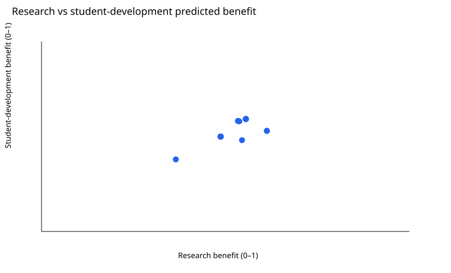
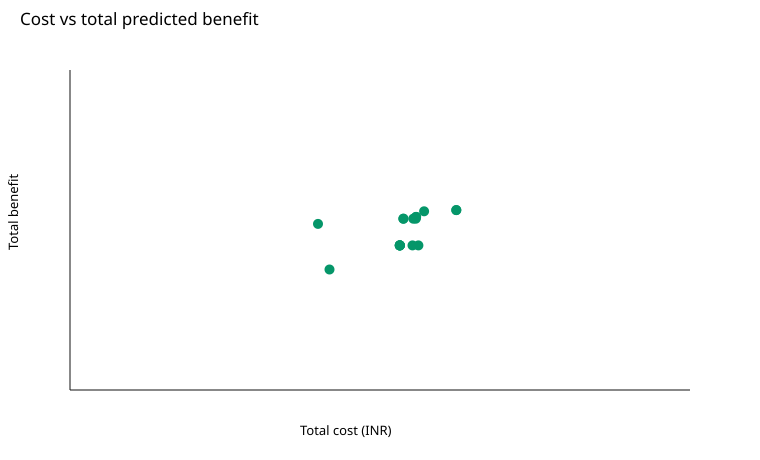

# VJTI public-plus-synthetic experiment report

Protocol `vjti_public_plus_synthetic_experiments_v1` was frozen before pilot. Final comparison: **18/18 complete**; matched budget **16** per run (`algorithm_metrics.csv`, run accounting JSON).

## Evidence boundary

Associational predictions from a VJTI-calibrated public-plus-synthetic methodological fixture.
No allocation is claimed to cause an outcome change.
DEA peers and efficiency are calibrated synthetic method-fixture context, not observed institutional rankings.

Public-only placement/higher-study denominator sensitivity is isolated in `public_only_sensitivity.csv`; all allocation recommendations are mixed public-plus-synthetic scenario results.

## Algorithm comparison

| Algorithm | Runs | Median HV | Median IGD | Mean feasible rate |
|---|---:|---:|---:|---:|
| moead | 3 | 0.105284 | 0.197694 | 0.917 |
| mopso | 3 | 0.111222 | 0.140533 | 0.917 |
| nsga2 | 3 | 0.079879 | 0.180490 | 1.000 |
| nsga3 | 3 | 0.084316 | 0.169518 | 1.000 |
| random_search | 3 | 0.117516 | 0.171208 | 0.292 |
| rion | 3 | 0.088352 | 0.266525 | 0.417 |

Values come from `algorithm_summary.csv`; the pooled comparison front is `pooled_reference_front.csv`.

## Portfolio and scenarios

The artifact portfolio contains **18 strategies**, including current, supported policy preferences, and held-fixed/reoptimized scenario pairs. **11 recommendation records** are retained. Duplicate and no-match outcomes remain in `strategy_selection_log.csv` (rows: 11).

Allocations and concrete increase/decrease/hold actions: `strategy_allocations.csv` and `current_vs_strategy_actions.csv`; KPI intervals: `strategy_kpis.csv`; constraints/resources: `strategy_constraints.csv` and `strategy_resource_summary.csv`; objective evidence and synthetic coverage: `strategy_objectives.csv`; uncertainty: `strategy_uncertainty.csv` using `common_uncertainty_draws.csv`.

Every recommendation row carries feasibility and model-support fields. An out-of-support recommendation is a visible warning, not validation. Held-fixed results are evaluated without repair; scenario reoptimization is separately labeled.

## Uncertainty and context

Common draws were applied to **18 strategies**. Downside means total predicted benefit below the saved current-strategy threshold; feasibility combines deterministic resource feasibility with uncertain service KPI thresholds (`strategy_uncertainty.csv`).

DEA context is copied in `dea_context.json` and remains a calibrated synthetic method fixture. Prediction intervals quantify model/scenario uncertainty; they do not identify causal impact.

## Independent checks

- PASS — `declared_comparison_runs_complete`: 18/18
- PASS — `matched_accounting_independently_checked`: 16
- PASS — `metrics_independently_recomputed`: hypervolume from saved archives
- PASS — `synthetic_coverage_complete`: four rows per strategy
- PASS — `recommendations_feasible`: saved evaluator results
- PASS — `support_warning_visible`: columns retained

The manifest hashes every report input. Rebuilding this report reads saved artifacts only.
