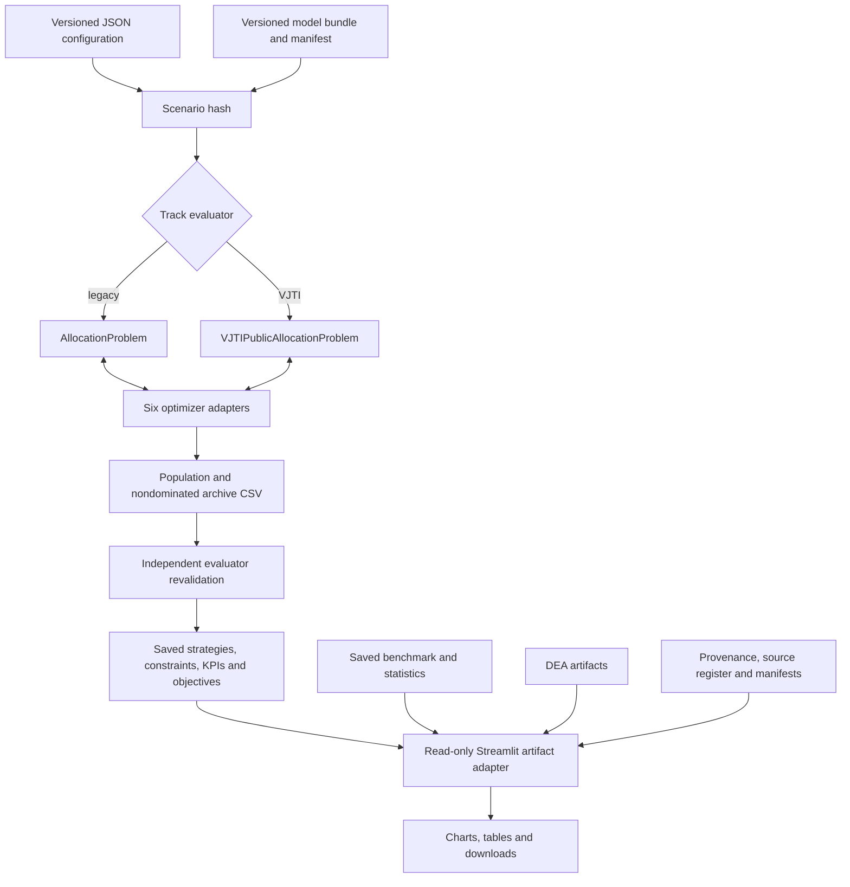

# Dashboard integration contract

**Contract version:** 1  
**Frozen:** 12 November 2026  
**Scope:** Prompt 1, repository audit and integration boundary only

## Acceptance statement

This contract traces a real saved VJTI public-calibrated plus synthetic candidate from
its frozen configuration and model bundle, through `VJTIPublicAllocationProblem`, to
the saved MOPSO archive row used by the dashboard fixture. It does not add a service,
run an optimizer, train a model, call an LLM, or change scientific logic.

The current evidence supports a reproducible methodological scenario study. It does
not support causal claims, empirically validated VJTI allocation effects, or policy
automation.

## Stack decision

Continue with the existing Streamlit frontend in `streamlit_app/`.

Reasons:

- The repository is Python-first and both canonical evaluators are Python classes.
- Streamlit is already the documented primary UI and has contract-aware artifact
  loaders, tests, and evidence-lane separation.
- A second JavaScript evaluation layer would create avoidable drift.
- Prompt 2 can add a small Python job/API boundary if durable asynchronous execution is
  needed. Prompt 1 does not add that boundary.
- The React/Vite code in `frontend/` remains a deprecated fallback and receives no new
  visualization work.

## Actual control and data flow



DEA is a separate descriptive analysis. No DEA score is applied to candidate
allocations or objective values.

## Canonical evaluator tracks

### Legacy synthetic track

- Evaluator: `department_optimizer.allocation.problem.AllocationProblem`
- Configuration: `configs/allocation/legacy_synthetic_method_fixture.json`
- Model bundle: `artifacts/models/legacy_synthetic_response_v1/`
- Workflow: `department_optimizer.allocation.workflow.run_workflow`
- CLI: `python main.py allocation --config <configuration>`
- Optimizer fixture outputs: `results/allocation_runs/`
- Supported objective evidence: research only in the legacy fixture
- Unsupported objective families: innovation, student, and societal are explicit
  zero-score unsupported families

`AllocationProblem.evaluate()` returns:

- decoded and repaired decisions plus repair actions;
- model features, raw KPIs, and prediction intervals;
- benefit and minimization score for four objective families;
- objective support flags;
- named raw and normalized constraint residuals;
- normalized violation, nominal feasibility, and robust feasibility;
- probability status without inventing a joint probability;
- cost, budget remaining, model-support warnings, and DEA status.

### VJTI public-calibrated plus synthetic track

- Evaluator: `department_optimizer.public_allocation.problem.VJTIPublicAllocationProblem`
- Configuration: `configs/public_allocation/vjti_four_family_v1.json`
- Model bundle: `artifacts/evidence_modeling/vjti_v1/`
- Workflow: `department_optimizer.public_allocation.workflow`
- Experiment runner: `department_optimizer.public_experiments.workflow`
- CLIs:
  - `python -m department_optimizer.public_allocation.run --config configs/public_allocation/vjti_four_family_v1.json`
  - `python -m department_optimizer.public_experiments.run --config configs/public_experiments/vjti_experiments_v1.json`

`VJTIPublicAllocationProblem.evaluate()` returns:

- decoded and repaired decisions plus repair actions;
- cost components, total cost, and budget remaining;
- model features, raw KPIs, conformal intervals, and response adjustments;
- objective components, benefits, minimization scores, and evidence labels;
- support and extrapolation warnings;
- named raw and normalized constraint residuals;
- normalized violation and feasibility;
- synthetic coverage by objective family;
- an explicit statement that DEA is descriptive context only.

`evaluate_fixed()` performs no repair. Use it for held-fixed and already saved archive
candidates. Use `evaluate()` for a new optimizer candidate that is allowed to pass
through canonical repair.

## Typed boundary definitions

Executable definitions are frozen in
`streamlit_app/data/integration_contract.py`:

- `EvidenceLabel`: field-level observed, derived, descriptive, synthetic, and
  unsupported classifications.
- `DecisionVariableContract`: value, unit, type, bounds, increment, cost mode, and
  evidence.
- `ScenarioInputRecord`: scenario identity, hash, track, evaluator, budget, currency,
  faculty supply, evidence class, and source paths.
- `ObjectiveFamilyRecord`: family name, benefit, optimizer score, scale definition,
  evidence, and synthetic coverage.
- `ConstraintResidualRecord`: named residual, normalized residual, and pass state.
- `UncertaintyRecord`: KPI point prediction, interval, validation type, and evidence.
- `EvaluatorResultRecord`: feasibility, costs, support state, objectives,
  constraints, uncertainty, and DEA boundary.
- `CandidateRecord`: candidate identity, scenario hash, source run, source row,
  algorithm, seed, decisions, and evaluator result.
- `BenchmarkRecord`: benchmark identity, jobs, algorithms, seeds, evaluation budget,
  and source artifacts.

All numeric values crossing the boundary must be finite. Candidate and scenario hashes
must match. Uncertainty bounds must contain the point prediction. A candidate from one
scenario cannot be compared as if it belonged to another scenario.

## Stable identity and accounting

- Scenario hash: SHA-256 of the canonical JSON containing track ID, full validated
  allocation configuration, configuration hash, and model-manifest hash.
- Candidate ID: first 24 hexadecimal characters of the SHA-256 over scenario hash,
  source run ID, source row, and ordered decision values.
- Saved example run ID:
  `vjti_public_plus_synthetic_experiments_v1:mopso:seed_17001`.
- Saved example candidate source:
  `artifacts/public_experiments/vjti_v1/runs/comparison/mopso/seed_17001/archive.csv#row=4`.
- The example run used 16 matched candidate evaluations, with 4 initialization calls
  and 12 evolution calls. Its accounting artifact reports 16 unique shared-evaluator
  calls and zero cache hits.
- Future live runs must persist a run ID, scenario hash, candidate ID, evaluator
  version, seed, evaluation budget, model identifiers, source hashes, and exact
  evaluator-call accounting.

## Frozen real example fixture

`streamlit_app/tests/fixtures/vjti_contract_v1.json` is generated from repository
artifacts, not hand-entered results.

The fixture contains:

- all 12 saved decision values from the selected MOPSO archive row;
- bounds, increments, types, units, cost modes, and evidence labels from the VJTI
  allocation configuration;
- a fresh `evaluate_fixed()` result from the canonical VJTI evaluator;
- objective records, all named constraint residuals, and all KPI intervals;
- the source run status and evaluation accounting;
- hashes for every source used by the fixture;
- final benchmark completion metadata.

Regenerate it only after an intentional, reviewed source change:

```bash
.venv/bin/python -m streamlit_app.data.integration_contract
```

## Supported dynamic input edits

The existing public experiment runtime currently supports these scenario overrides:

- `budget_limit`, in INR;
- `fixed_context.faculty_total`, in annual faculty FTE supply;
- `decision_variables.<name>.cost_multiplier`, as a dimensionless unit-cost shock for
  an existing decision variable.

The frozen public experiment presets are:

- base budget: INR 36,000,000;
- lean budget: INR 30,000,000;
- expanded budget: INR 42,000,000;
- faculty shock: faculty total reduced from 15 to 13;
- patent support cost multiplier: 1.25;
- compute capacity cost multiplier: 1.25.

These overrides still pass through the same evaluator, repair, dependency, service,
integrality, increment, and conservative KPI rules. Prompt 2 must expose an allowlist,
not arbitrary nested configuration editing.

The following changes require regenerated artifacts or retraining and are not live
dashboard inputs:

- decision variable names, types, bounds, increments, or model mappings;
- objective KPI composition, weights, directions, or normalization ranges;
- KPI model features, targets, training data, support ranges, or conformal radii;
- public evidence values, derivations, snapshots, or source register;
- DEA inputs, outputs, peer cohort, or mathematical formulation;
- optimizer implementation or benchmark protocol changes.

## Evidence dictionary

- `observed_public`: directly recorded in a public source snapshot.
- `derived_public`: calculated from public values with a recorded derivation.
- `public_descriptive`: public descriptive context that does not identify an
  intervention effect.
- `public_validated`: reserved for a claim validated against suitable public evidence;
  no VJTI KPI response in the current package qualifies.
- `synthetic_calibrated`: generated or assumed value calibrated to public context.
- `synthetic_scenario`: modeled scenario response or objective result.
- `unsupported`: data or functionality is absent and must not be inferred.

The top-level UI lanes remain:

- `synthetic_method_fixture`;
- `public_plus_synthetic_scenario`;
- `empirical_descriptive`.

## Unit dictionary

VJTI public-calibrated track:

- `INR`: seven direct funding decisions and the total budget. Currency basis is
  FY2023-24 nominal and is not inflation adjusted.
- `annual FTE`: research, student-support, and service faculty effort.
- `headcount`: research assistants, integer increment 1.
- `configured compute unit`: compute capacity, integer increment 1.
- `normalized benefit [0, 1]`: objective display value, with higher better.
- `optimizer score`: negative normalized benefit, with lower better. Do not display it
  as a percentage.
- KPI units: use the KPI registry and data dictionary in
  `artifacts/evidence_modeling/vjti_v1/kpi_evidence_registry.csv` and
  `artifacts/public_data/vjti_ceit_v1/data_dictionary.csv`.

Legacy synthetic track:

- `synthetic nominal INR`: research budget.
- `fraction of annual faculty effort`: two research-effort fractions.
- `supported centre`: integer centre count.
- `supported collaboration`: integer collaboration-support count.

Money, FTE, fractions, headcounts, configured units, KPI values, and normalized scores
must never share one quantitative axis unless separately faceted and clearly labelled.

## Exact saved artifact sources

Public data and provenance:

- `artifacts/public_data/vjti_ceit_v1/manifest.json`
- `artifacts/public_data/vjti_ceit_v1/source_register.csv`
- `artifacts/public_data/vjti_ceit_v1/source_to_field_traceability.csv`
- `artifacts/public_data/vjti_ceit_v1/provenance_coverage.csv`
- `artifacts/public_data/vjti_ceit_v1/data_dictionary.csv`
- `artifacts/public_data/vjti_ceit_v1/public_only.csv`
- `artifacts/public_data/vjti_ceit_v1/public_plus_synthetic.csv`
- `artifacts/public_data/vjti_ceit_v1/realism_accounting_checks.csv`

Models, intervals, and DEA:

- `artifacts/evidence_modeling/vjti_v1/model_manifest.json`
- `artifacts/evidence_modeling/vjti_v1/model_metrics.csv`
- `artifacts/evidence_modeling/vjti_v1/interval_calibration.csv`
- `artifacts/evidence_modeling/vjti_v1/kpi_evidence_registry.csv`
- `artifacts/evidence_modeling/vjti_v1/leakage_checks.json`
- `artifacts/evidence_modeling/vjti_v1/dea_summary.json`
- `artifacts/evidence_modeling/vjti_v1/dea_efficiency.csv`
- `artifacts/evidence_modeling/vjti_v1/dea_peer_weights.csv`
- `artifacts/evidence_modeling/vjti_v1/dea_variable_provenance.csv`

Public-calibrated optimization and strategies:

- `artifacts/public_allocation/vjti_v1/reference_evaluation.json`
- `artifacts/public_allocation/vjti_v1/allocation_checks.csv`
- `artifacts/public_experiments/vjti_v1/experiment_manifest.json`
- `artifacts/public_experiments/vjti_v1/algorithm_metrics.csv`
- `artifacts/public_experiments/vjti_v1/strategy_allocations.csv`
- `artifacts/public_experiments/vjti_v1/strategy_kpis.csv`
- `artifacts/public_experiments/vjti_v1/strategy_objectives.csv`
- `artifacts/public_experiments/vjti_v1/strategy_constraints.csv`
- `artifacts/public_experiments/vjti_v1/strategy_uncertainty.csv`
- `artifacts/public_experiments/vjti_v1/current_vs_strategy_actions.csv`

Final synthetic benchmark and statistics:

- `results/benchmarks/phase6-final-synthetic-25seeds-v1/completion.json`
- `results/benchmarks/phase6-final-synthetic-25seeds-v1/per_seed_metrics.csv`
- `results/benchmarks/phase6-final-synthetic-25seeds-v1/summary_median_iqr.csv`
- `results/benchmarks/phase6-final-synthetic-25seeds-v1/statistical_tests.csv`
- `results/benchmarks/phase6-final-synthetic-25seeds-v1/benchmark_manifest.json`

Robustness:

- `results/robustness/phase6b-synthetic-v1/scenario_catalog.csv`
- `results/robustness/phase6b-synthetic-v1/strategy_scenario_assessments.csv`
- `results/robustness/phase6b-synthetic-v1/monte_carlo_summary.csv`
- `results/robustness/phase6b-synthetic-v1/assumption_sensitivity.csv`
- `results/robustness/phase6b-synthetic-v1/fixed_vs_reoptimized_comparison.csv`

## Benchmark contract

The final synthetic benchmark is complete:

- configured jobs: 150;
- completed jobs: 150;
- failed jobs: 0;
- algorithms: MOEA/D, MOPSO, NSGA-II, NSGA-III, random search, and RION;
- seeds: 11001 through 11025;
- matched target candidate evaluations: 100 per job.

Interactive future runs must be shown separately from this completed benchmark. One
interactive run cannot be added to the 25-seed statistical comparison.

## Native RION status

The optional OpenMP library `libRION/libpso.so` is not built in this workspace. Serial
RION is available. The full backend test command runs 90 tests, with 84 passing and 6
native-only tests skipped. The dashboard must not claim native performance.

## Known unsupported functionality

- distributed or multi-process live-run workers; Prompt 2 provides one local
  in-process worker with persisted status, restart detection, and explicit retry;
- arbitrary nested configuration edits;
- causal or empirically validated allocation effects;
- public VJTI DEA, because there are 0 complete comparable public DMUs against 12
  required;
- network DEA and multi-period planning, blocked by evidence gaps;
- a guaranteed global optimum for reverse target-cost search;
- Groq selecting recommendations, calculating facts, invoking optimization, or acting
  as a source of numerical or feasibility authority;
- native OpenMP RION execution in the reported workspace;
- comparing candidates across scenario hashes without an explicit normalized
  comparison contract.

## Contract tests

Tests are in `streamlit_app/tests/test_integration_contract.py` and verify:

- the committed fixture schema and all source hashes;
- real saved decisions re-evaluate through `VJTIPublicAllocationProblem`;
- costs, objectives, and KPI intervals match the frozen result;
- units and evidence labels come from the actual configuration;
- scenario hashes are deterministic and change when supported inputs change;
- the final benchmark contains 150 completed matched-budget jobs;
- a candidate with a mismatched scenario hash is rejected.

Run:

```bash
.venv/bin/python -m unittest streamlit_app.tests.test_integration_contract -v
.venv/bin/python -m unittest discover -s streamlit_app/tests -v
.venv/bin/python -m unittest discover -s tests -v
```

## Prompt 1 gate

The gate passes when the committed fixture can be regenerated, all source hashes match,
and archive row 4 from the saved MOPSO seed-17001 run re-evaluates through the canonical
VJTI evaluator with matching decisions, units, cost, feasibility, objectives, and KPI
intervals.

No visualization, API, optimizer, model, or Groq integration is added in Prompt 1.

## Prompt 2 implementation note

Prompt 2 resolves the planned live-run service gap through `streamlit_app/api/`.
The service accepts only the allowlisted VJTI overrides defined above, persists stable
run and scenario identities, executes the existing optimizer adapters, checks exact
evaluation accounting, and independently revalidates saved archive candidates through
`VJTIPublicAllocationProblem`. API behavior and failure states are documented in
`docs/frontend/API.md`.

## Prompt 3 implementation note

The Streamlit application now calls the Prompt 2 API over HTTP. Department Overview
and Resource Planner use backend defaults, validation, live status, persisted run
identities, and independently revalidated candidates. Strategy Comparison accepts only
candidates from the same run. Experiment and evidence views keep the completed
synthetic benchmark, current interactive run, blocked public DEA, and synthetic DEA
fixture visibly separate. No optimizer, repair, prediction, or constraint formula is
implemented in the UI.

## Prompt 4 implementation note

`streamlit_app/api/recommendations.py` is the deterministic decision-support layer.
It uses the existing public-experiment preference weights and canonical evaluator,
selects only independently revalidated feasible candidates, discloses duplicate profile
selections, and abstains when the reference or valid candidate pool is missing. The API
exposes recommendation facts and controlled one-factor sensitivity results. Held-fixed
without repair and reoptimized assessments are stored and rendered separately. No LLM
is called in this phase.

## Prompt 5 implementation note

`streamlit_app/api/explanations.py` adds one optional wording-only provider call after
deterministic recommendation selection. `GroqExplanationProvider.generate` is the only
production network call site. It receives a minimal allowlisted packet and has no tool,
retrieval, evaluator, mutation, or optimizer access. The response must satisfy the
strict explanation schema and local semantic validator. Any unavailable, malformed,
unsupported, contradictory, or ungrounded response falls back to deterministic text.
The UI defaults to rule-based wording, discloses Groq transmission before the explicit
request, labels the result mode, and continues to render exact structured backend facts
as the authority.

## Prompt 6 implementation note

The existing benchmark and evidence endpoints now return the complete versioned records
needed by the research views. Experiment Lab reads 150 saved per-seed metric rows, 48
median/IQR summaries, and 60 supported paired tests while keeping the current
interactive run separate. Evidence & Assumptions reads public source and data registers,
the blocked public DEA assessment, the labeled synthetic DEA fixture, nine KPI model and
interval records, public audit checks, and saved robustness comparisons. Held-fixed and
reoptimized modes remain visibly distinct. The Advisor report export is assembled only
from structured backend recommendation and run fields; it does not call an LLM or add a
second evaluator.
