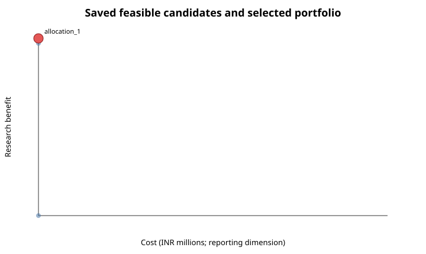
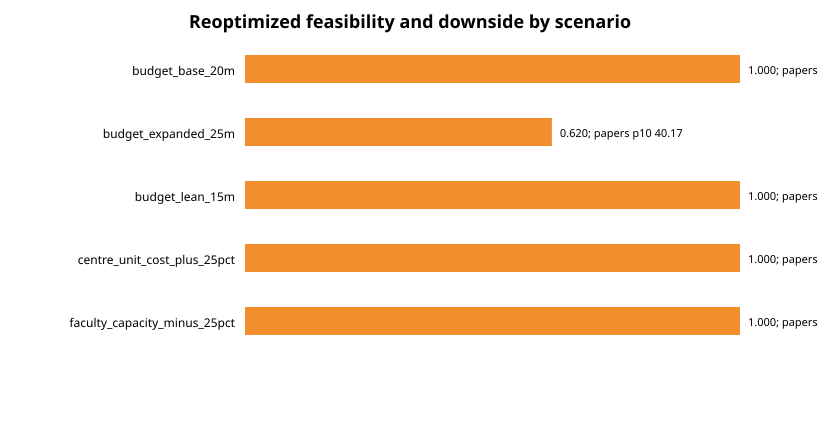
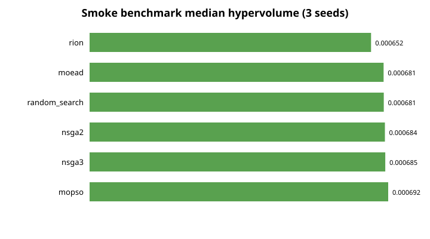

# Department allocation strategy portfolio

> **Synthetic methodological prototype.** The current allocation is illustrative, and modeled KPI changes are not causal estimates.

## Decision summary

Six declared selection rules produced 1 unique allocation(s). Repeated labels are retained and explicitly linked through `allocation_group` rather than presented as independent choices.

| Strategy | Selection Status | Allocation Group | Duplicates Another Strategy | Probability Feasible | Unsupported Preference Weight | Knee Status |
| --- | --- | --- | --- | --- | --- | --- |
| conservative | selected | allocation_1 | True | 1.000 | 0.00 | not_used |
| balanced | selected | allocation_1 | True | 1.000 | 0.75 | not_used |
| research_first | selected | allocation_1 | True | 1.000 | 0.30 | not_used |
| innovation_first | selected | allocation_1 | True | 1.000 | 0.90 | not_used |
| student_first | selected | allocation_1 | True | 1.000 | 0.90 | not_used |
| compromise | selected | allocation_1 | True | 1.000 | 0.00 | unavailable_fewer_than_two_varying_supported_objectives |

Declared selection rules:

- **conservative**: Require Monte Carlo feasibility >= 0.95; maximize research-benefit p10; break ties by lower cost.
- **balanced**: Use the declared balanced post-optimization policy weights.
- **research_first**: Use the declared research-first post-optimization policy weights.
- **innovation_first**: Use the declared innovation-first weights and flag unsupported evidence.
- **student_first**: Use the declared student-first weights and flag unsupported evidence.
- **compromise**: Minimize normalized distance to the supported-objective ideal; a knee is unavailable when fewer than two supported objectives vary.

A Pareto knee cannot be identified because only one supported objective varies. The compromise rule therefore uses distance to the supported-objective ideal. Innovation-first and student-first carry 90% weight on unsupported objective families and cannot substantiate those policy labels.



## Current versus optimized allocation

| Variable | Unit | Current | Recommended | Difference |
| --- | --- | --- | --- | --- |
| research_budget | synthetic nominal INR | 8,000,000.00 | 19,900,000.00 | 11,900,000.00 |
| frac_research_phd | fraction of annual faculty effort | 0.50 | 0.75 | 0.25 |
| frac_research_other | fraction of annual faculty effort | 0.25 | 0.48 | 0.23 |
| centres_of_excellence_count | supported centre | 2.00 | 0.00 | -2.00 |
| industry_collaboration_support_count | supported collaboration | 4.00 | 0.00 | -4.00 |

Concrete actions for the unique recommendation:

- Increase research funding by INR 11,900,000 to INR 19,900,000.
- Increase frac_research_phd by 0.25 fraction of annual faculty effort to 0.75.
- Increase frac_research_other by 0.23 fraction of annual faculty effort to 0.48.
- Remove centres_of_excellence_count by 2 supported centre to 0.
- Remove industry_collaboration_support_count by 4 supported collaboration to 0.

## Predicted outcomes and resources

| Kpi | Current Prediction | Recommended Prediction | Predicted Difference | Recommended Lower | Recommended Upper | Monte Carlo P10 Downside |
| --- | --- | --- | --- | --- | --- | --- |
| papers_t1 | 17.5025 | 41.2929 | 23.7904 | 37.5648 | 45.0209 | 38.1243 |
| citation_percentile_avg | 0.6218 | 0.6320 | 0.0102 | 0.6122 | 0.6519 | 0.6165 |

| Strategy | Cost | Budget Utilization | Research Fte | Research Fte Utilization |
| --- | --- | --- | --- | --- |
| current_reference | INR 12,000,000 | 60.0% | 50.00 | 62.5% |
| conservative | INR 19,900,000 | 99.5% | 79.20 | 99.0% |

All saved current and selected-strategy constraint rows pass: True. Constraint residuals and utilization are exported separately for audit.

## Scenario robustness



| Assessment Mode | Assessed Scenario Id | Probability Feasible | Papers T1 Mean | Papers T1 P10 Downside | Research Benefit Mean |
| --- | --- | --- | --- | --- | --- |
| reoptimized | budget_base_20m | 1.000 | 41.147 | 38.124 | 0.587 |
| reoptimized | budget_expanded_25m | 0.620 | 43.193 | 40.169 | 0.613 |
| reoptimized | budget_lean_15m | 1.000 | 31.403 | 28.380 | 0.478 |
| reoptimized | centre_unit_cost_plus_25pct | 1.000 | 41.188 | 38.164 | 0.587 |
| reoptimized | faculty_capacity_minus_25pct | 1.000 | 40.467 | 37.444 | 0.579 |
| fixed_baseline_strategy | budget_lean_15m | 0.000 | 41.147 | 38.124 | 0.587 |
| fixed_baseline_strategy | budget_base_20m | 1.000 | 41.147 | 38.124 | 0.587 |
| fixed_baseline_strategy | budget_expanded_25m | 1.000 | 41.147 | 38.124 | 0.587 |
| fixed_baseline_strategy | faculty_capacity_minus_25pct | 0.000 | 41.147 | 38.124 | 0.587 |
| fixed_baseline_strategy | centre_unit_cost_plus_25pct | 1.000 | 41.147 | 38.124 | 0.587 |

Held-fixed and reoptimized rows answer different questions: the former measures resilience of the base decision, while the latter permits adaptation. Low/base/high assumption results are available in `assumption_sensitivity.csv`; these are sensitivity cases rather than calibrated confidence levels.

## Algorithm benchmark



The algorithm table is a three-seed smoke benchmark with matched 100-candidate budgets. It supports integration checks and descriptive medians, not a best-algorithm claim.

| Algorithm | Runs | Median | Q1 | Q3 |
| --- | --- | --- | --- | --- |
| moead | 3 | 0.000681 | 0.000677 | 0.000682 |
| mopso | 3 | 0.000692 | 0.000688 | 0.000692 |
| nsga2 | 3 | 0.000684 | 0.000682 | 0.000686 |
| nsga3 | 3 | 0.000685 | 0.000684 | 0.000686 |
| random_search | 3 | 0.000681 | 0.000679 | 0.000682 |
| rion | 3 | 0.000652 | 0.000635 | 0.000670 |

## Method and evidence limits

- The report reads saved outputs and does not implement or call a second scientific evaluator.
- Only the research objective has a trained synthetic response model. Innovation, student, and societal benefits are unsupported zeros.
- The illustrative current allocation is not an observed departmental baseline.
- Prediction intervals and Monte Carlo assumptions do not establish causal intervention effects.
- Patent and compute cost shocks remain unsupported because those decision variables are absent.
- DEA remains a separate benchmarking analysis and is not applied as a causal multiplier.

## Reproduction

```bash
make benchmark-smoke
make robustness-smoke
make strategy-report
```

The benchmark and robustness commands resume saved jobs. `make strategy-report` rebuilds this report from their validated artifacts.

## Proposal traceability

The portfolio supplies declared policy rules, baseline differences, predicted KPIs with uncertainty, constraint and resource checks, trade-off figures, algorithm summaries, scenario robustness, and reproducible commands. Empirical validation and unsupported KPI families remain open evidence gaps.
